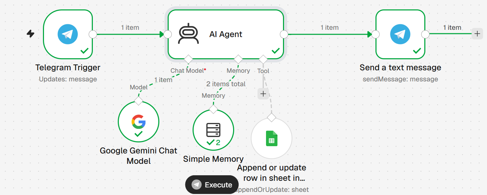
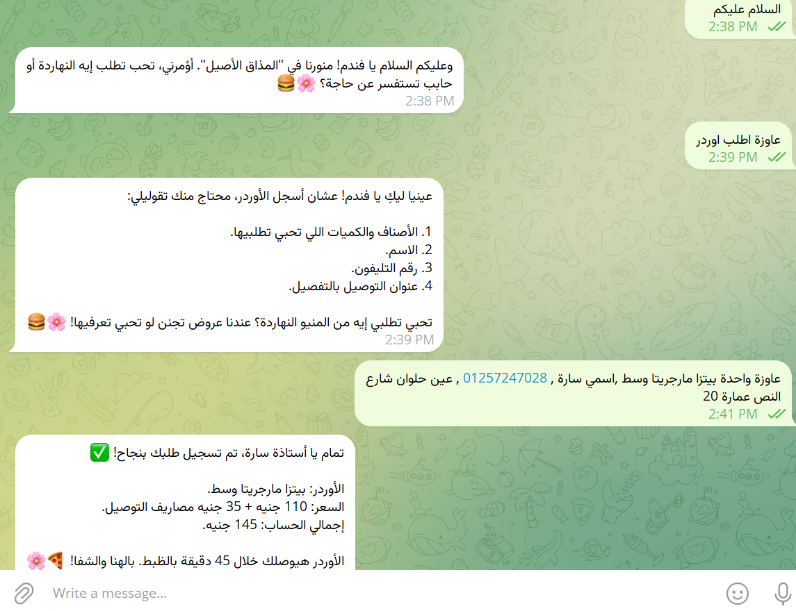
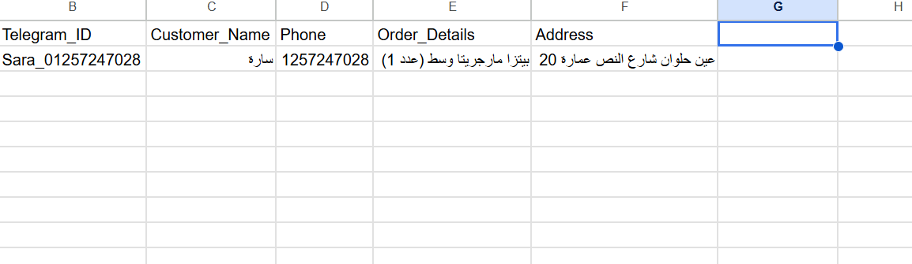

# 🍽️ AI-Powered Restaurant Customer Service Bot

An AI-powered restaurant customer service automation project built with **n8n, Telegram, Google Gemini, and Google Sheets**.

This project was developed as my final project during the **AI Ambassadors Program – Advanced Level**.

## 📌 Project Overview

The AI-Powered Restaurant Customer Service Bot is designed to automate restaurant customer interactions through Telegram.

It acts as a virtual customer service assistant that responds to customer inquiries, provides restaurant information, and collects order details.

The workflow uses an AI Agent with memory to manage conversations and a Google Sheets integration to store customer order information.

## ✨ Key Features

- **Automated Customer Support:** Responds to customer questions in Egyptian Arabic.
- **Menu & Pricing Information:** Provides menu items, prices, and available offers.
- **Restaurant Information:** Answers questions about working hours and delivery.
- **Order Collection:** Collects order items, customer name, phone number, and delivery address.
- **Conversation Memory:** Maintains conversational context using an AI memory component.
- **Google Sheets Integration:** Stores customer and order information through an automated workflow.
- **Telegram Integration:** Provides a simple interface for customers to interact with the assistant.

## 🛠️ Technologies Used

| Technology | Purpose |
|---|---|
| n8n | Workflow automation |
| Telegram Bot API | Customer interaction |
| Google Gemini | AI language model |
| AI Agent | Understanding and responding to customer messages |
| Simple Memory | Maintaining conversation context |
| Google Sheets | Storing customer and order information |

## 🔄 Workflow Architecture

The workflow consists of the following components:

1. **Telegram Trigger:** Receives incoming customer messages.
2. **AI Agent:** Processes customer messages and generates responses.
3. **Google Gemini Chat Model:** Powers the AI Agent's responses.
4. **Simple Memory:** Maintains conversational context.
5. **Google Sheets Tool:** Appends or updates customer order information.
6. **Telegram Send Message:** Sends the AI-generated response back to the customer.

## 📸 Project Screenshots

The `screenshots` folder contains visual examples of the project.

### 1. Workflow Overview



### 2. Telegram Bot Demo



### 3. Google Sheets Integration



## 📂 Repository Structure

```text
Restaurant-AI-Customer-Service-Bot/
│
├── screenshots/
│   ├── workflow-overview.png
│   ├── telegram-demo.png
│   └── google-sheets-integration.png
│
├── Restaurant_AI_Customer_Service_Project_Sanitized.json
│
└── README.md
```

## 🚀 How to Import the Workflow

To use this workflow in your own n8n instance:

1. Download the sanitized JSON workflow file from this repository.
2. Open your n8n workspace.
3. Select **Import from File**.
4. Choose the downloaded JSON file.
5. Configure your own credentials for:
   - Telegram Bot API
   - Google Gemini API
   - Google Sheets OAuth2
6. Replace the placeholder Google Sheets document reference with your own spreadsheet.
7. Check the Telegram recipient/chat ID configuration and make sure it uses the appropriate chat ID.
8. Verify the Google Sheets columns and mappings.
9. Test the workflow with your own Telegram bot before activating it.

**Important:** The exported workflow does not include your personal credentials. Each user must configure their own accounts and connections.

## 🎯 Project Goal

The goal of this project was to apply AI and workflow automation concepts to a practical business scenario, demonstrating how AI agents can support customer service operations and automate repetitive tasks.

## 👩‍💻 Project Information

**Program:** AI Ambassadors Program – Advanced Level

**Project:** AI-Powered Restaurant Customer Service Bot

**Repository:** [GitHub Project Repository](https://github.com/Menna171/Restaurant-AI-Customer-Service-Bot)

---

*Built as a hands-on learning project exploring AI agents, conversational automation, and workflow integration.*
